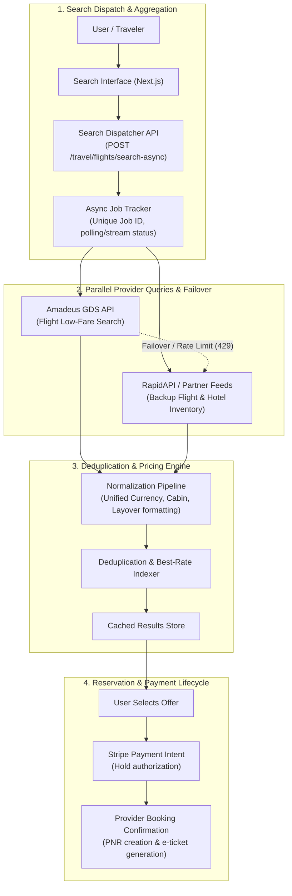

# ✈️ Distributed Travel Search & Booking Aggregator
### *High-Throughput Multi-Provider Flight & Hotel Search Engine with Dynamic Provider Failover*

[](https://nestjs.com/)
[](https://www.typescriptlang.org/)
[](https://developers.amadeus.com/)
[](https://www.prisma.io/)
[](https://nextjs.org/)
[](LICENSE)

A resilient, multi-provider travel aggregation platform engineered to query, normalize, deduplicate, and rank flight and hotel inventory across global distribution systems (**Amadeus GDS**) and aggregator APIs. Features non-blocking asynchronous search job workers, dynamic provider failover, rate-limit backoff handling, and end-to-end booking confirmation workflows.

---

## 🏗️ System Architecture



---

## ✨ Production Architectural Highlights

* **Asynchronous Search Workers:** Decouples slow third-party GDS responses from the client UI using polling job tickets with progressive status updates.
* **Dynamic Provider Failover:** Automatic circuit-breaker switching from primary GDS feeds (Amadeus) to secondary aggregator providers upon timeouts or HTTP 429 rate limits.
* **Unified Inventory Normalization:** Canonical normalization layer transforming disparate provider schemas into standardized flight legs, cabin classes, baggage policies, and hotel room amenities.
* **Two-Phase Booking Pipeline:** Enforces payment authorization holds via Stripe prior to provider reservation requests, automatically releasing holds if downstream ticket issuance fails.
* **Resilient Rate-Limit Backoff:** Exponential backoff retry logic preserving API quota limits across high-concurrency search peaks.

---

## 🛠️ Technology Stack

* **Backend Framework:** NestJS v10 (TypeScript)
* **Travel APIs:** Amadeus Self-Service GDS SDK, RapidAPI Hotel & Flight Feeds
* **Database & ORM:** PostgreSQL / Prisma ORM v6
* **Payments:** Stripe SDK (PaymentIntents, Pre-authorization holds)
* **Frontend:** Next.js 15, React 19, Tailwind CSS
* **Authentication:** JWT, Passport.js

---

## 📁 Repository Structure

```text
├── frontend/
│   └── app/
│       └── search/
│           └── travel/            # Flight & hotel search interface with filters
├── prisma/
│   └── schema.prisma              # Relational models (Booking, SearchJob, User)
├── src/
│   ├── auth/                      # JWT authentication & session guards
│   ├── payments/                  # Stripe payment authorization & capture
│   └── travel/
│       ├── bookings/              # Reservation lifecycle, PNR tracking & records
│       ├── flights/               # Asynchronous flight query engine & Amadeus adapter
│       └── hotels/                # Hotel inventory search, room rates & details
└── nest-cli.json
```

---

## 🔌 Core API Endpoints

| Method | Endpoint | Description |
| :--- | :--- | :--- |
| `POST` | `/travel/flights/search-async` | Dispatches asynchronous flight search across providers |
| `GET` | `/travel/flights/job/:jobId` | Polls progress and retrieves aggregated flight results |
| `POST` | `/travel/hotels/search` | Queries multi-provider hotel availability & room tiers |
| `POST` | `/travel/bookings/create` | Initializes booking record and requests payment authorization |
| `POST` | `/travel/bookings/:id/confirm` | Finalizes provider PNR reservation and captures payment |

---

## ⚡ Quickstart

```bash
# 1. Install dependencies
npm install

# 2. Configure environment variables
cp .env.example .env

# 3. Generate Prisma client & run migrations
npx prisma generate
npx prisma migrate dev

# 4. Start local development server
npm run start:dev
```
